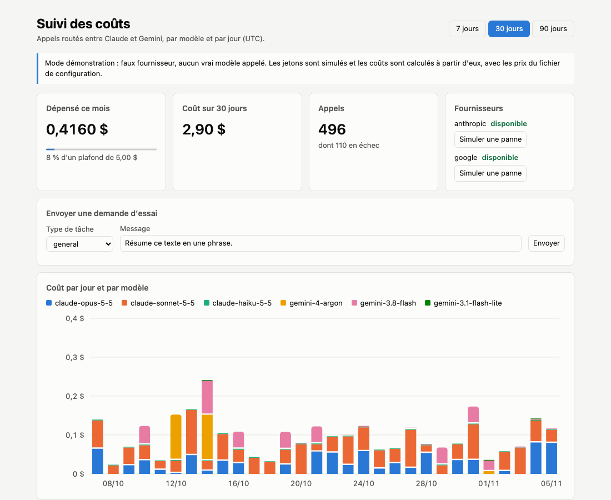

# routeur-ia

[](https://github.com/KorayAkyk/routeur-ia/actions/workflows/ci.yml)

Service Flask qui reçoit une demande et choisit le modèle adapté entre Claude et Gemini, selon des
règles lisibles. Il gère la bascule en cas d'erreur, les nouvelles tentatives, un budget plafond, et
tient un journal des appels avec leurs jetons et leur coût.

*In English: a Flask service that routes each request to a suitable Claude or Gemini model using
readable rules (task type, length, remaining budget, provider outage). It handles failover, retries
with exponential backoff and a hard budget cap, logs tokens and cost per call in SQLite, and shows
costs per model and per day on a small dashboard. It runs and is fully tested without any API key,
thanks to a fake provider. Calls to the real models have never been run.*



## Le problème

Envoyer toutes les demandes au modèle le plus capable coûte cher. Tout envoyer au moins cher dégrade
les tâches difficiles. Dépendre d'un seul fournisseur rend le service indisponible dès qu'il tombe.
Et sans suivi, la facture n'est connue qu'à la fin du mois.

Ce service place ces décisions à un seul endroit : un fichier de configuration et quelques règles
qu'on peut lire, tester et expliquer. Chaque réponse indique pourquoi ce modèle a été choisi.

## Le routage

```text
POST /v1/demandes
       |
       v
  tache .......... le type de tâche donne le niveau : eco, standard ou expert
       |
  longueur ....... demande générale courte : eco / texte long : au moins standard
       |
  budget ......... moins de 30 % restants : un niveau en dessous / moins de 10 % : eco
       |
  candidats ...... les modèles du niveau ; texte très long : le moins cher en entrée d'abord
       |
  pannes ......... fournisseur en panne ou sans clé : écarté
       |
       v
  pour chaque candidat, dans l'ordre :
       |
       +-- réserver son coût maximal --------> ne tient pas : candidat suivant
       |                                       aucun ne tient : 402 budget_epuise
       +-- appeler le modèle
       |     surcharge, délai, coupure ......> attendre, réessayer (0,5 s, 1 s, ... plafonné)
       |     essais épuisés, clé refusée ....> candidat suivant (bascule)
       |     refus du modèle ................> candidat suivant, coût compté
       |     demande invalide ...............> 422, sans bascule
       |
       +-- écrire le journal, libérer la réservation, répondre
       |
  plus aucun candidat : 503 aucun_fournisseur
```

Après trois appels perdus de suite, un fournisseur est écarté pendant deux minutes. Les seuils, les
niveaux, les modèles et les prix sont dans [`config/routeur.toml`](config/routeur.toml).

| Modèle par niveau | Claude | Gemini |
| --- | --- | --- |
| eco | `claude-haiku-5-5` | `gemini-3.1-flash-lite` |
| standard | `claude-sonnet-5-5` | `gemini-3.8-flash` |
| expert | `claude-opus-5-5` | `gemini-4-argon` |

**Les prix du fichier de configuration sont à vérifier.** Ils ont été relevés à la main le 2026-11-05
sur les pages publiques des fournisseurs et ne se mettent pas à jour seuls. Google annonce déjà des
hausses sur deux de ces modèles, signalées en commentaire dans le fichier.

## Lancer sans aucune clé

```bash
make demo
```

Il faut `make`, et `uv` ou Python 3.12. La commande crée l'environnement virtuel dans le dossier du
projet, installe les dépendances verrouillées, génère un historique simulé puis ouvre le service sur
<http://127.0.0.1:8000/>. La page permet d'envoyer une demande d'essai et de simuler la panne d'un
fournisseur pour voir la bascule. Aucun appel ne sort de la machine.

```bash
curl -s -X POST http://127.0.0.1:8000/v1/demandes -H 'Content-Type: application/json' \
  -d '{"tache": "code", "message": "Corrige ce bug."}'
```

| Route | Rôle |
| --- | --- |
| `POST /v1/demandes` | Route et exécute une demande. Renvoie le texte, le coût, la trace du routage et les essais. |
| `POST /v1/routage/simuler` | Montre la décision de routage, sans appel ni dépense. |
| `POST /v1/agent` | Boucle d'agent avec deux outils sans effet de bord : `calculer` et `date_du_jour`. |
| `GET /v1/couts?jours=30` | Coûts par jour et par modèle. |
| `GET /v1/budget` | Plafond, dépense du mois, solde. |
| `GET /` | Page de suivi. |
| `GET /sante` | État du service. |

## Tester

```bash
make verifier   # ruff, mypy, pytest (couverture minimale de 90 %), parcours Playwright
make test       # pytest seul, sans navigateur
make e2e        # Playwright seul ; Chromium est rangé dans .venv
```

Aucun test ne peut joindre un fournisseur. Un garde-fou coupe au niveau du socket toute connexion
hors de la machine, et un test vérifie qu'il fonctionne. Les adaptateurs sont testés à travers les
vrais SDK, branchés sur un transport HTTP simulé. La CI GitHub Actions lance les mêmes étapes.

## Brancher de vraies clés

Les clés viennent uniquement des variables d'environnement ; [`.env.example`](.env.example) les
liste, vides. Le service ne lit aucun fichier `.env` tout seul. Une clé présente ne suffit pas : le
mode réel se demande explicitement.

```bash
export ROUTEUR_MODE=reel
export ANTHROPIC_API_KEY=...      # ou GEMINI_API_KEY, ou les deux
.venv/bin/routeur-ia serve
```

Un fournisseur sans clé est écarté du routage. Écouter ailleurs que sur la machine locale exige de
définir `ROUTEUR_JETON_API`, qui protège alors l'API et la page de suivi.

## Choix techniques

- **Règles en fonctions pures.** Le routage ne touche ni au réseau, ni à l'horloge, ni à la base.
  Chaque règle se teste seule et laisse une trace, renvoyée au client.
- **Adaptateurs derrière une interface commune** (`domaine.Fournisseur`), sur les SDK officiels
  `anthropic` et `google-genai`. Les erreurs sont classées en trois familles, qui décident seules de
  la suite : transitoire, indisponible, demande invalide.
- **Une seule couche de reprises.** Celles du SDK sont coupées, sinon les deux niveaux se multiplient.
- **Le tour du modèle est gardé tel quel.** Claude exige ses blocs de réflexion intacts, Gemini ses
  signatures. Le format commun ne les représente pas : ils repartent bruts vers le même fournisseur.
  Après une bascule en cours d'agent, les tours de l'autre fournisseur sont aplatis en texte.
- **Pas de repli côté serveur pour les refus de Claude.** L'API en propose un, mais la bascule du
  routeur traite déjà ce cas, y compris vers Gemini, et compte le coût de l'essai refusé.
- **Réservation avant l'appel.** Le coût réel n'est connu qu'après. Chaque appel réserve donc son coût
  maximal sous verrou, ce qui tient le plafond quand plusieurs demandes arrivent en même temps.
- **Coûts en nano-dollars entiers.** Pas de flottant : la somme reste exacte en SQL. Les paliers de
  prix sont gérés, et la réflexion de Gemini, comptée à part par l'API, est facturée en sortie.
- **Le journal ne garde aucun contenu.** Ni demande ni réponse : seulement modèle, jetons, coût,
  durée et statut. Un test le vérifie dans les fichiers de la base.
- **Mode faux par défaut.** Impossible de déclencher un appel payant sans le demander.
- **SQLite et rendu serveur.** Pas de service à installer, pas de bibliothèque de graphiques :
  le graphique est un SVG généré en Python, et une politique CSP stricte interdit tout code en ligne.
- **`calculer` lit l'arbre syntaxique** et n'accepte que des nombres et des opérateurs, sans `eval`.

## Limites connues

- **Les vrais modèles n'ont jamais été appelés.** Les adaptateurs sont vérifiés contre les SDK, pas
  contre les API réelles. Les noms de modèles et les prix n'ont donc pas été validés par un appel.
- Le plafond tient dans un seul processus : la réservation et le disjoncteur sont en mémoire.
  Plusieurs processus partageraient le journal, mais pas les réservations.
- Avant l'appel, l'entrée est estimée à un jeton pour trois caractères. Une entrée plus dense que
  cette estimation peut faire dépasser le plafond de l'écart constaté.
- Ni diffusion en continu, ni cache de requêtes, ni vidéo ou image : seul le texte est pris en charge.
- Le réglage `effort` ne s'applique qu'à Claude. Il n'est pas transmis à Gemini.

## Structure

```text
config/routeur.toml      modèles, prix, seuils, reprises
src/routeur_ia/
  routage.py             règles de routage
  service.py             réservation, reprises, bascule, journal
  tentatives.py          attente croissante
  sante.py               disjoncteur par fournisseur
  budget.py  couts.py    plafond et calcul de coût
  journal.py             SQLite
  fournisseurs/          Claude, Gemini, faux fournisseur
  agent/                 boucle d'agent et outils
  web/                   API, page de suivi, sécurité
tests/                   pytest, et e2e/ pour Playwright
```

## Licence

[MIT](LICENSE), Koray Akyurek.
